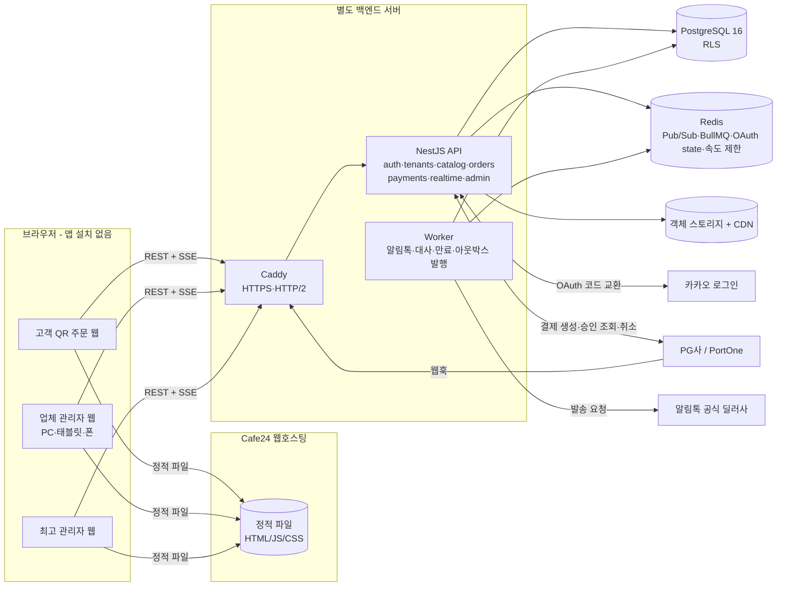

# 1단계 설계 제안서

> 작성일 2026-10-29 · 대상: Multi-Tenant QR Table Order Platform
> 이 문서는 의뢰서 21장의 10개 분석 항목에 대한 답입니다. 항목 4·5·6·10은 분량이 커서 별도 문서로 나눴습니다.
>
> | 항목 | 위치 |
> |---|---|
> | 1. 기술 스택 | 이 문서 §1 |
> | 2. Cafe24 / 백엔드 역할 분리 | 이 문서 §2, 상세는 [06-deployment.md](06-deployment.md) |
> | 3. 아키텍처와 데이터 흐름 | 이 문서 §3 |
> | 4. ERD | [02-erd.md](02-erd.md) |
> | 5. 권한과 데이터 격리 | [03-tenancy-and-permissions.md](03-tenancy-and-permissions.md) |
> | 6. 결제 연동 전략 | [04-payments.md](04-payments.md) |
> | 7. 실시간 주문과 알림톡 | 이 문서 §4 |
> | 8. 단계별 작업 목록 | 이 문서 §5 |
> | 9. 기술적 위험과 대응 | 이 문서 §6 |
> | 10. 외부 계정·계약 | [07-external-accounts.md](07-external-accounts.md) |
> | API 명세 초안 | [05-api-spec.md](05-api-spec.md) |
> | 구현 현황·테스트 결과 | [STATUS.md](STATUS.md) |

---

## 1. 권장 기술 스택과 선택 이유

| 영역 | 선택 | 이유 | 검토한 대안 |
|---|---|---|---|
| 프런트엔드 | **React 18 + Vite + TypeScript, 정적 SPA 3개** (고객 `order`, 업체 `merchant`, 최고 관리자 `admin`) | Cafe24 일반 웹호스팅은 Node 런타임이 없어도 빌드된 정적 파일(HTML/JS/CSS)만으로 동작해야 합니다. Vite SPA 는 서버 없이 배포되고, 세 앱을 분리하면 고객 번들에 관리자 코드가 섞이지 않습니다. | Next.js: SSR·API 라우트를 쓰려면 Node 서버가 필요해 Cafe24 일반 호스팅과 맞지 않고, `output: 'export'` 로 쓰면 장점 대부분이 사라집니다. 고객 화면 SEO 필요성이 없어 SPA 로 충분합니다. |
| UI | Tailwind CSS + Radix UI 기반 공용 컴포넌트(`packages/ui`) | 반응형(PC·태블릿·스마트폰) 대응이 빠르고, 접근성 있는 기본 컴포넌트 | MUI(번들이 큼) |
| 서버 상태 | TanStack Query | 재연결 후 재조회, 캐시 무효화를 표준 방식으로 처리 | Redux |
| 백엔드 | **Node.js 22 + NestJS 11 + TypeScript, 모듈형 단일 서버(모놀리스)** | 의뢰서 권장과 같고, 모듈 경계(auth, tenants, catalog, orders, payments, realtime, notifications, admin)를 강제하기 좋습니다. API 서버와 작업 처리기(worker)는 같은 코드베이스를 다른 진입점으로 실행합니다. | Fastify 단독(구조를 직접 만들어야 함), Spring Boot(팀 스택이 TS 단일화되지 않음) |
| DB 접근 | **Kysely(타입 안전 SQL 빌더) + 수동 SQL 마이그레이션** | 요청마다 트랜잭션 안에서 `SET LOCAL app.tenant_id` 를 걸어 RLS 를 적용해야 하는데, Prisma 는 이 패턴이 불편합니다. 마이그레이션을 SQL 로 두면 RLS·트리거·제약조건을 그대로 검토할 수 있습니다. | Prisma, TypeORM, Drizzle |
| 데이터베이스 | **PostgreSQL 16** (운영은 관리형 권장) | RLS, 부분 유니크 인덱스, `NULLS NOT DISTINCT`, JSONB, 트랜잭션 DDL | MySQL(Cafe24 기본 제공이지만 RLS 없음) |
| 실시간 | **SSE(Server-Sent Events)** + Redis Pub/Sub | 주문 알림은 서버→브라우저 단방향이라 SSE 로 충분하고, 브라우저 기본 자동 재연결과 `Last-Event-ID` 재전송을 그대로 씁니다. 명령(접수·완료)은 REST 로 보냅니다. | WebSocket/Socket.IO: 양방향이 필요 없고 프록시·재연결 처리가 더 복잡합니다. 나중에 필요하면 realtime 모듈만 교체합니다. |
| 비동기 작업 | **Redis 7 + BullMQ** | 알림톡 발송·재시도, 결제 대사, 미결제 주문 만료 같은 지연·반복 작업 | 관리형 큐(SQS 등) — 규모가 커지면 교체 |
| 이미지 저장 | **S3 호환 객체 스토리지** (NCP Object Storage 또는 AWS S3 서울 리전) + CDN | 서버 디스크와 분리되어 백엔드 서버를 늘려도 문제 없음. 업로드는 백엔드가 검증·재인코딩(sharp)한 뒤 저장 | Cafe24 FTP 디스크(백엔드에서 쓰기 어려움) |
| 인증 | 서버 세션(HttpOnly·Secure 쿠키) + DB 세션 테이블 | 즉시 로그아웃·강제 만료가 가능하고 토큰이 JS 에 노출되지 않음 | JWT(폐기가 어려움) |
| 검증 | zod 스키마를 프런트·백엔드 공유(`packages/shared`) | 입력값 검증 규칙을 한 곳에서 관리 | class-validator 단독 |
| 테스트 | Vitest(단위·DB 통합), Supertest(API), Playwright(브라우저·모바일 에뮬레이션), k6(부하) | | Jest |
| 모니터링 | Sentry(오류), pino 구조화 로그(민감정보 마스킹), Uptime 체크, 운영자 오류 화면(결제·웹훅·알림 실패) | | Datadog(비용) |
| 배포 | 프런트: Cafe24 정적 호스팅 / 백엔드: 국내 리전 VPS 또는 클라우드 VM 에서 Docker Compose(api, worker, Caddy) + 관리형 PostgreSQL + Redis | 초기 비용과 운영 단순성의 균형 | Kubernetes(초기에 과함) |

**모놀리스로 시작하는 이유**: 업체 수 수백·주문 초당 수십 건 수준까지는 단일 API 서버 2대 + 워커 1대로 충분합니다. 실시간 이벤트는 Redis Pub/Sub 으로 서버 간에 전달하므로 API 서버를 수평 확장할 수 있고, 모듈 간 호출은 서비스 인터페이스로만 하므로 나중에 결제·알림 모듈을 분리할 수 있습니다.

## 2. Cafe24 와 별도 백엔드의 역할 분리

| 기능 | Cafe24 | 백엔드 서버 |
|---|---|---|
| 고객 QR 주문 웹 / 업체 관리자 웹 / 최고 관리자 웹 | 빌드된 정적 파일 제공 | – |
| 도메인·HTTPS (프런트) | Cafe24 도메인 연결 + 무료 SSL | – |
| SPA 라우팅 | `.htaccess` 로 모든 경로를 `index.html` 로 (Apache mod_rewrite 지원 여부 **확인 필요**) | – |
| 로그인 화면·메뉴·장바구니·주문 상태 **화면** | O | 데이터는 전부 API 로 |
| 카카오 OAuth 코드 교환, 세션 발급 | – | O (시크릿은 서버에만) |
| 권한·업체 소유권 검증, 메뉴·테이블·주문·결제·환불·통계 API | – | O |
| PG 웹훅 수신, 결제 승인 검증 | – | O (PG 가 서버로 직접 호출) |
| SSE 실시간 연결 | – | O (오래 유지되는 연결은 정적 호스팅이 못 함) |
| 알림톡 발송·재시도, 스케줄 작업 | – | O (worker) |
| 메뉴 이미지 | – | 업로드 검증 후 객체 스토리지에 저장, CDN 으로 제공 |

**Cafe24 상품 확인 결과와 결정**: Cafe24 일반 웹호스팅은 PHP/Apache 기반이며 FTP 로 파일을 올리는 구조라 상시 실행되는 Node 서버, WebSocket/SSE 장시간 연결, 백그라운드 작업을 쓸 수 있다고 가정하지 않습니다. 따라서 Cafe24 는 **정적 파일 제공 전용**으로 쓰고 모든 서버 기능은 별도 백엔드로 보냅니다. 2026년 8월 Cafe24 가 개발언어 VPS 호스팅을 출시했다는 보도가 있어, 백엔드도 Cafe24 안에서 운영할지는 상품 사양(Docker 가능 여부, 고정 IP, 방화벽, 백업)을 확인한 뒤 결정합니다. 자세한 확인 항목은 [06-deployment.md](06-deployment.md) 에 있습니다.

**도메인 구성(권장)**: 같은 등록 도메인 아래 서브도메인으로 둡니다. 예) `order.example.kr`(고객), `partner.example.kr`(업체), `admin.example.kr`(최고 관리자) → Cafe24, `api.example.kr` → 백엔드. 같은 사이트(same-site)이므로 `SameSite=Lax` 세션 쿠키가 동작하고, CORS 는 위 세 오리진만 허용합니다.

## 3. 전체 아키텍처와 데이터 흐름



### 3-1. 주문 한 건의 데이터 흐름

1. **QR 스캔** → `order.example.kr/q/{token}`. 프런트가 `GET /api/qr/{token}` 호출 → 서버가 `app.resolve_qr_token` 으로 업체·매장·테이블을 확인. 토큰이 무효면 "사용할 수 없는 QR" 화면.
2. **주문 컨텍스트 고정** → 서버는 확인된 `{tenantId, storeId, tableId}` 를 서버 세션에 저장하고, 이후 주문 API 는 URL 파라미터가 아니라 **세션의 컨텍스트**만 씁니다. URL 의 업체 ID 를 바꿔도 다른 매장에 접근할 수 없습니다.
3. **카카오 로그인** → `GET /api/auth/kakao/start?returnTo=/q/{token}` → state(Redis, 10분)·PKCE 생성 → 카카오 → `/api/auth/kakao/callback` 에서 state·redirect URI 검증, 코드 교환, 회원번호로 `user_identities` 연결 → 세션 쿠키 발급 → `returnTo`(허용 목록 검증) 로 복귀.
4. **메뉴 조회** → RLS 컨텍스트 = 세션의 tenantId. 해당 업체 메뉴만 반환.
5. **장바구니** → 브라우저 로컬 상태(sessionStorage). 가격 표시용일 뿐 서버는 신뢰하지 않음.
6. **주문 생성** `POST /api/orders` (멱등성 키 = `client_request_id`) → 서버가 메뉴·옵션·품절·판매 시간·영업 상태를 다시 읽고 금액을 **다시 계산** → `orders(pending_payment)` + 스냅샷 저장.
7. **결제 요청** `POST /api/payments` → `payments(ready)` + 고유 `payment_request_id` 발급 → 프런트가 PG 결제창 호출.
8. **결제 승인 확인** → 프런트 복귀 시 `POST /api/payments/{id}/confirm`, 그리고 PG 웹훅이 각각 도착. 둘 다 **PG 서버 API 로 결제를 다시 조회**해 상태·금액을 확인한 뒤, 하나의 트랜잭션에서 `payments=paid` → `orders=placed`. 이미 처리됐으면 아무 일도 하지 않음(멱등).
9. **업체 알림** → 같은 트랜잭션의 `outbox_events` 행을 워커가 Redis 로 발행 → 해당 업체 SSE 연결에 `order.status_changed` 전송 → 업체 화면 알림음.
10. **조리·완료** → 직원이 `PATCH /api/merchant/orders/{id}/status` (`expectedVersion` 포함) → 상태 전이 규칙·낙관적 잠금 검사 → 이력·아웃박스 기록 → 고객 SSE 갱신 + `ready` 이면 알림톡 작업 큐 등록.
11. **기준 데이터는 DB** → SSE 가 끊겨도 재연결 시 `Last-Event-ID` 이후 이벤트를 다시 보내고, 프런트는 주문 목록을 다시 조회합니다.

### 3-2. 저장소 구조 (계획)

```
qr-order-platform/
├─ apps/
│  ├─ api/            NestJS API + worker (1단계: DB 마이그레이션·테스트만 존재)
│  │  ├─ db/migrations/   SQL 마이그레이션
│  │  ├─ src/db/          마이그레이션 실행기
│  │  └─ test/            DB 통합 테스트
│  ├─ order/          고객 QR 주문 SPA        (2단계)
│  ├─ merchant/       업체 관리자 SPA          (2단계)
│  └─ admin/          최고 관리자 SPA          (5단계)
├─ packages/
│  ├─ shared/         zod 스키마, 상태 상수, 금액 계산 함수 (2단계)
│  └─ ui/             공용 컴포넌트 (2단계)
├─ docs/              설계·운영 문서, 테스트 결과
├─ docker-compose.yml 로컬 PostgreSQL·Redis
└─ .env.example
```

## 4. 실시간 주문과 알림톡 구조

두 기능은 **서로 다른 모듈**이며, 둘 다 주문 트랜잭션이 커밋된 뒤에만 동작합니다. 어느 쪽이 실패해도 주문 처리는 멈추지 않습니다.

```mermaid
sequenceDiagram
  participant API as API (주문 상태 변경)
  participant DB as PostgreSQL
  participant W as Worker (outbox relay)
  participant R as Redis
  participant SSE as API 인스턴스들 (SSE)
  participant Q as BullMQ notifications
  participant BIZ as 알림톡 딜러사

  API->>DB: BEGIN; UPDATE orders; (트리거) history + outbox_events; COMMIT
  W->>DB: SELECT outbox_events WHERE published_at IS NULL FOR UPDATE SKIP LOCKED
  W->>R: PUBLISH tenant:{id} / order:{id}
  R-->>SSE: 구독 중인 연결에 event id=outbox.id 전송
  W->>DB: notifications INSERT (dedupe_key UNIQUE)
  W->>Q: 발송 작업 등록
  Q->>BIZ: 발송 요청 (승인된 템플릿·발신 프로필)
  BIZ-->>Q: 성공 / 실패 코드
  Q->>DB: notifications 상태·실패 사유·시도 횟수 기록, 실패 시 지수 백오프 재시도
```

### 4-1. 실시간 화면 알림 (SSE)

- 채널: 업체 `GET /api/merchant/stream` (직원 세션, 업체 전체 또는 매장 필터), 고객 `GET /api/orders/{id}/stream` (본인 주문만).
- 이벤트 ID = `outbox_events.id`. 브라우저가 재연결할 때 보내는 `Last-Event-ID` 이후 이벤트를 DB 에서 다시 읽어 보냅니다. 재연결 직후 프런트는 목록을 한 번 더 조회해 상태를 맞춥니다.
- 중복 방지: 프런트는 `(orderId, version)` 으로 이미 반영한 이벤트를 무시합니다.
- 연결 유지: 20초마다 주석 하트비트, 프록시 타임아웃 대비. Caddy 에서 HTTP/2 를 켜 브라우저 동시 연결 6개 제한을 피합니다.
- 여러 기기(PC·태블릿·폰) 동기화: 모든 기기가 같은 업체 채널을 구독하므로 한 기기의 접수가 다른 기기에 바로 반영됩니다.
- 알림음: 첫 사용자 상호작용(“알림 켜기” 버튼) 이후에만 재생 가능(브라우저 자동재생 정책). 미처리 주문이 있으면 탭 제목·배지로도 표시하고, 같은 주문은 한 번만 울립니다.

### 4-2. 카카오 알림톡

- 공식 딜러사(비즈메시지 사업자) API 를 `NotificationProvider` 인터페이스 뒤에 둡니다. 계약 전에는 `DisabledProvider`(발송 안 함, `skipped: provider_not_configured` 기록)만 동작합니다. **가짜 발송을 성공으로 기록하지 않습니다.**
- 발송 조건(모두 충족해야 함): 업체 설정 `alimtalk_enabled`, 이벤트가 `alimtalk_events` 에 포함, 고객이 휴대폰 번호를 직접 입력하고 수신 동의(`customer_contacts.alimtalk_consent`), 해당 이벤트의 `approved` 템플릿 존재. 하나라도 빠지면 `skipped` + 사유를 기록합니다.
- **카카오 로그인만으로 전화번호를 얻는다고 가정하지 않습니다.** 카카오 로그인의 전화번호 동의 항목은 비즈 앱 전환·검수가 필요하고, 받더라도 알림톡 수신 동의와는 별개입니다. 기본 설계는 주문 완료 화면에서 “준비 완료 알림 받기” 로 번호를 입력받는 방식입니다.
- 재시도: 일시 오류는 1분·5분·15분·1시간 백오프로 최대 5회. 영구 오류(번호 오류, 템플릿 불일치)는 즉시 `failed`. 대체 발송(SMS)은 업체가 켠 경우에만, 별도 `notifications` 행(`fallback_of`)으로 기록.
- 템플릿 버전 관리: `notification_templates(code, channel, version, status)`. 승인된 버전만 발송에 사용하고 발송 기록에 템플릿 ID 를 남깁니다.

## 5. 개발 단계별 작업 목록

각 단계는 테스트 결과를 [STATUS.md](STATUS.md) 에 기록하고 통과해야 다음 단계로 넘어갑니다.

### 1단계 — 아키텍처·설계 (현재)
- [x] 설계 문서(이 문서, ERD, 권한, 결제, API 초안, 배포, 외부 계약)
- [x] 모노레포 기본 설정, `.env.example`, docker-compose
- [x] DB 마이그레이션 6개 + 마이그레이션 실행기
- [x] DB 계층 테스트(격리·상태 전이·결제/환불 무결성·QR·감사 로그)
- [ ] Cafe24 상품 실제 확인(사용자 계정 필요) → 배포 구조 확정

### 2단계 — 고객 주문·업체 관리
- NestJS 골격: 설정 검증, 요청 컨텍스트(트랜잭션 + `SET LOCAL`), 오류 형식, 로깅 마스킹, 속도 제한, CSRF
- 직원 이메일 로그인(argon2id), 업체 가입 신청, 최고 관리자 승인 API
- 카카오 로그인(state·PKCE·redirect 검증·복귀), 약관 동의, 회원 탈퇴
- 매장·테이블·QR 발급/재발급/폐기, QR PNG·인쇄용 PDF 일괄 출력
- 메뉴·카테고리·옵션 CRUD, 이미지 업로드 검증, 판매 시간, 복제, 정렬
- 금액 계산 모듈(공용) + 서버 재계산, 주문 생성(멱등)
- 고객 SPA(메뉴·검색·상세·장바구니·주문 내역), 업체 SPA(대시보드·메뉴·테이블)
- 업체 대시보드는 2단계에서 폴링, 4단계에서 SSE 로 교체
- 테스트: 의뢰서 18장 1~12, 34

### 3단계 — 결제·주문 상태
- PG 계약 방식 확정 후 `PaymentProvider` 어댑터(PortOne V2 우선) 테스트 연동
- 결제 생성·승인 확인·웹훅(서명 검증·중복 제거)·재조회 대사 작업·미결제 만료
- 승인 후 주문 확정 실패 복구, 금액 불일치 자동 취소
- 부분·전체 환불(멱등), 업체 접수 거절 시 자동 환불
- 운영자 오류 화면(웹훅 실패·불일치)
- 테스트: 13~22

### 4단계 — 실시간·알림톡
- 아웃박스 릴레이 워커, Redis Pub/Sub, SSE 엔드포인트, 재연결 재전송
- 알림음·미처리 배지, 여러 기기 동기화
- 알림톡 딜러사 어댑터, 연락처 입력·동의, 템플릿 관리, 재시도·대체 발송
- 테스트: 23~28

### 5단계 — 최고 관리자·운영
- 업체 승인·정지·해제, 관리자 계정, 공지, 운영 로그·감사 로그 조회
- 주문·결제·환불·오류 현황, 업체별 이용·매출 통계(일별 집계 테이블 추가)
- 직원 초대·권한 변경 화면
- 테스트: 권한별 최고 관리자 개인정보 접근 제한

### 6단계 — 테스트·배포
- Playwright(모바일·태블릿·PC), k6 동시 주문 부하, 백업·복원 리허설, 재시작 테스트, 의존성 점검
- staging·production 배포, 운영자 매뉴얼, 실결제 전환 체크리스트
- 테스트: 29~35

## 6. 예상 기술 위험과 해결 방법

| # | 위험 | 영향 | 대응 |
|---|---|---|---|
| 1 | API 코드에서 업체 조건을 빠뜨려 다른 업체 데이터 노출 | 치명 | 1차 API 가드(멤버십·역할), 2차 PostgreSQL RLS(컨텍스트 없으면 0행), 3차 복합 외래 키. 업체 간 격리 자동 테스트를 CI 필수로 |
| 2 | 결제는 됐는데 주문이 안 생김(승인 직후 서버 중단) | 높음 | 주문을 결제 전에 `pending_payment` 로 먼저 저장. 웹훅·복귀·대사 작업 세 경로가 모두 같은 멱등 확정 함수를 호출. 5분마다 `ready/pending` 결제를 PG 에 재조회 |
| 3 | 웹훅 중복·순서 뒤바뀜 | 중복 환불 등 | `payment_events (provider, provider_event_id)` UNIQUE, 웹훅 본문을 믿지 않고 PG 에서 재조회, 상태 전이 규칙으로 역행 차단 |
| 4 | 클라이언트 가격 조작 | 금전 손실 | 서버 재계산, `payments.amount` 는 서버 값, 승인 금액 ≠ 청구 금액이면 DB 제약으로 `paid` 불가 → 자동 취소 |
| 5 | 다중 업체 정산 구조(플랫폼이 대금을 받으면 전자금융업 이슈) | 법적 | 초기에는 **업체별 PG 가맹점 계약**(대금이 업체로 직접 정산) 권장. 플랫폼 일괄 수납은 PG 사 지급대행 상품 계약 후에만 ([04-payments.md](04-payments.md)) |
| 6 | 카카오페이가 PG 계약에 자동 포함된다는 오해 | 출시 지연 | PG 별 간편결제 신청·심사 여부를 계약 단계에서 확인. 미승인 수단은 결제창에 노출하지 않음(업체별 수단 설정) |
| 7 | 알림톡 발송 불가(번호 미확보·템플릿 미승인) | 기능 미동작 | SSE 화면 알림을 기본으로, 알림톡은 추가 수단. 발송 조건 미충족은 `skipped` 로 명확히 기록 |
| 8 | Cafe24 상품 제약(SPA 라우팅, 캐시) | 배포 실패 | 해시 라우팅 대체안 준비, 파일명 해시 + `index.html` 캐시 금지 |
| 9 | 모바일 브라우저 백그라운드에서 SSE 끊김 | 알림 누락 | `visibilitychange` 시 재연결·재조회, DB 가 기준 |
| 10 | 동시 처리 충돌(두 직원이 같은 주문 처리) | 상태 꼬임 | `version` 낙관적 잠금, 실패 시 409 + 최신 상태 재조회 |
| 11 | 피크 시간 동시 주문 | 지연 | 인덱스 설계, 커넥션 풀(PgBouncer transaction 모드는 `SET LOCAL` 과 호환), API 수평 확장, k6 부하 테스트 |
| 12 | 개인정보 과다 수집·보관 | 법적 | 카카오 동의 항목 최소화(닉네임만 선택), 전화번호 암호화, 탈퇴 시 비식별화, 보유 기간 배치 삭제 |
| 13 | 시크릿 유출 | 치명 | 환경변수·비밀 저장소, `.env` 커밋 금지, 로그 마스킹, PG 비밀키는 업체별 암호화 저장, gitleaks CI |
| 14 | 테스트 결제가 운영에 섞임 | 정산 오류 | 환경별 DB·키 분리 + `deployment_info.environment` 와 결제 환경 불일치 시 DB 가 거부(테스트로 검증됨) |
