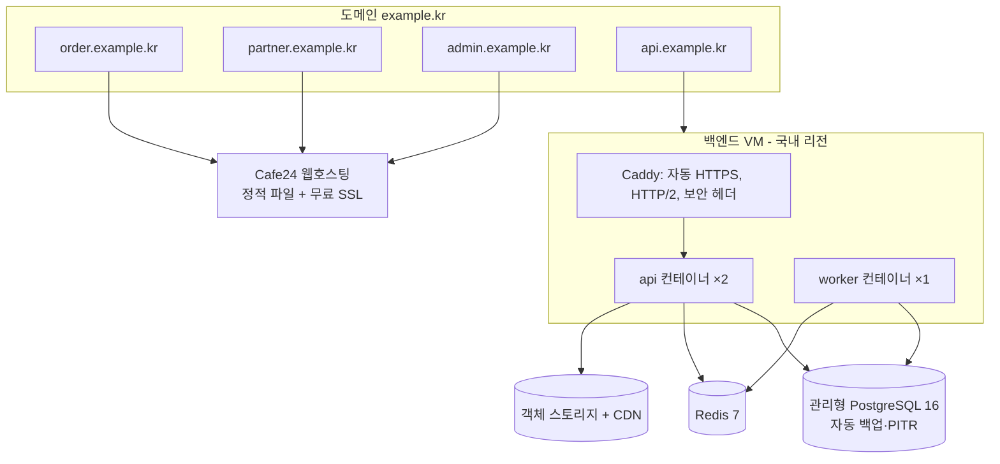

# 배포 구조와 Cafe24 제약 확인

## 1. Cafe24 제약 확인 결과

| 확인 항목 | 결과 | 근거·상태 |
|---|---|---|
| 일반 웹호스팅에서 정적 HTML/JS/CSS 제공 | 가능 | FTP 업로드 방식 웹호스팅 |
| 일반 웹호스팅에서 상시 Node.js 프로세스 실행 | **가정하지 않음** | PHP/Apache 기반 상품. 백엔드는 별도 서버로 분리 |
| SSE/WebSocket 장시간 연결 | **가정하지 않음** | 백엔드에서 처리 |
| 크론·백그라운드 작업 | **가정하지 않음** | 백엔드 worker 에서 처리 |
| SPA 경로 새로고침(`.htaccess` mod_rewrite) | **확인 필요** (상품 안내에 명시 없음) | 두 방식 모두 구현 완료: 일반 주소(`VITE_ROUTER=browser` + 함께 배포되는 `.htaccess`) / 해시 주소(`VITE_ROUTER=hash`, 서버 `ORDER_WEB_ROUTING=hash`, QR 주소가 `/#/q/토큰`). 해시 방식은 브라우저 점검으로 확인함 |
| 서브도메인 여러 개 | 상품마다 다름 | 뉴아우토반 퍼스트클래스: 서브도메인 20개 / 비즈니스: 서브도메인 없음 → 경로 분리(`/order`, `/partner`, `/admin`, `VITE_BASE_PATH`) |
| 무료 SSL | 기본 제공 도메인(mycafe24.com)만 무료로 안내됨 | 연결 도메인의 SSL 은 별도 신청·비용 확인 필요 |
| 홈페이지 호스팅(최저가 상품) | 사용하지 않음 | 서브도메인·서버 스크립트 불가 |
| Cafe24 리눅스 가상서버 | 2026-10 확인 시 품절 | 백엔드는 NCP 또는 AWS 서울 리전 |

### 추천 상품 (2026-10-29 Cafe24 공개 안내 기준, 가격은 바뀔 수 있음)

| 상품 | 월 요금(1년 약정 기준 안내가) | 트래픽 | 서브도메인 | 이 프로젝트에서 |
|---|---|---|---|---|
| **뉴아우토반 퍼스트클래스 (추천)** | 약 10,800원 | 하루 20GB | 20개 | `order.`·`partner.`·`admin.` 서브도메인 구성 가능 |
| 뉴아우토반 비즈니스 (최소 비용) | 약 6,300원 | 하루 10GB | 없음 | 한 도메인에 경로 분리로 3개 앱 배치 |

트래픽 추정: 화면 묶음(JS+CSS) 한 번에 약 100KB(gzip). 메뉴 이미지는 API 서버(나중에 객체 스토리지)에서 내려가므로 Cafe24 트래픽에 포함되지 않습니다.

### 쿠키·도메인 규칙 (중요)
- 세션 쿠키는 `SameSite=Lax` 이므로 **화면과 API 가 같은 등록 도메인(같은 사이트)** 이어야 합니다. 예: `order.example.kr` + `api.example.kr` (가능), `xxx.mycafe24.com` + `api.example.kr` (불가: 로그인이 유지되지 않음).
- 따라서 Cafe24 에 **자체 도메인을 연결**하고, 같은 도메인의 하위 이름으로 API 서버를 둡니다.
- `ORDER_WEB_ORIGIN` 은 경로를 포함할 수 있습니다(예: `https://www.example.kr/order`). CORS·CSRF 검사는 오리진(`https://www.example.kr`) 기준입니다.

## 2. 배포 구조

### 백엔드 서버 후보 (택1, 비용·계약 편의로 결정)
- Cafe24 개발언어 VPS 호스팅(사양 확인 후)
- NCP(네이버 클라우드) Server + Cloud DB for PostgreSQL + Object Storage
- AWS 서울 리전 Lightsail/EC2 + RDS PostgreSQL + S3

초기 권장 사양: 2 vCPU / 4GB VM 1대(api 2 + worker 1 컨테이너), 관리형 PostgreSQL 최소 사양 + 자동 백업, Redis(같은 VM 컨테이너로 시작 가능, 데이터 유실 시에도 DB 가 기준이라 복구 가능).

## 3. 환경 분리

| 환경 | 프런트 | API | DB | PG 키 | 카카오 앱 | 알림톡 |
|---|---|---|---|---|---|---|
| local | `localhost:5173~5175` | `localhost:3000` | docker-compose | 테스트 키 또는 없음 | 개발용 앱(Redirect URI localhost) | 비활성 |
| staging | `*.staging.example.kr` (Cafe24 하위 폴더 또는 별도) | `api.staging.example.kr` | 별도 DB, `deployment_info.environment='staging'` | **테스트 키만** | 개발용 앱 | 테스트 발신 또는 비활성 |
| production | `*.example.kr` | `api.example.kr` | 별도 DB, `'production'` | 실 키 | 운영 앱 | 실발송 |

테스트 결제가 운영 DB 로 들어오면 `PAYMENT_ENVIRONMENT_MISMATCH` 로 DB 가 거부합니다(테스트로 검증됨).

## 4. 배포 전 체크리스트

- [ ] 도메인·HTTPS: 4개 호스트 인증서 정상, HSTS
- [ ] API 접근: `GET /readyz` 200
- [ ] DB 연결, `pnpm db:migrate` 결과 확인, `pnpm db:status` 미적용 없음
- [ ] 카카오 Redirect URI 가 환경별로 등록됨, 카카오 REST API 키·Client Secret 은 서버 환경변수에만(프런트 빌드 변수 `VITE_*` 에 넣지 않음)
- [ ] 프런트 빌드 변수 확인: `VITE_API_BASE_URL`, `VITE_ROUTER`, `VITE_BASE_PATH`, 고객 앱 `VITE_DEV_LOGIN` 은 반드시 false
- [ ] DB 로그인 계정: `qr_api_login`(GRANT qr_app), `qr_worker_login`(GRANT qr_system) 생성, 비밀번호는 시크릿 저장소
- [ ] 최고 관리자 계정: 서버에서 `pnpm --filter @qr/api admin:create <email>`
- [ ] PG 테스트 결제 1건 + 웹훅 수신 확인 + 취소 확인
- [ ] 알림 서비스 설정(또는 비활성 상태 명시)
- [ ] 환경변수 등록(`.env.example` 전 항목), 시크릿 저장소 확인
- [ ] 백업 정책 확인 + 최근 복원 리허설 일자
- [ ] Sentry 오류 수집 확인
- [ ] 장애 시 롤백 절차(이전 이미지 태그) 확인

배포 명령·스크립트·Cafe24 FTP 업로드 절차는 6단계에서 실제 환경으로 검증한 뒤 작성합니다(현재 미작성).
