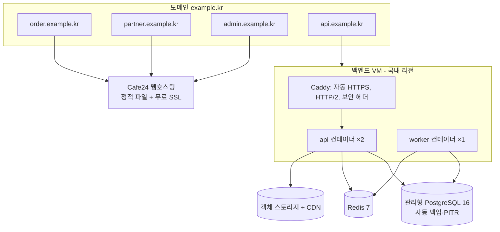

# 배포 구조와 Cafe24 제약 확인

## 1. Cafe24 제약 확인 결과

| 확인 항목 | 결과 | 근거·상태 |
|---|---|---|
| 일반 웹호스팅에서 정적 HTML/JS/CSS 제공 | 가능 | FTP 업로드 방식 웹호스팅 |
| 일반 웹호스팅에서 상시 Node.js 프로세스 실행 | **가정하지 않음** | PHP/Apache 기반 상품. 백엔드는 별도 서버로 분리 |
| SSE/WebSocket 장시간 연결 | **가정하지 않음** | 백엔드에서 처리 |
| 크론·백그라운드 작업 | **가정하지 않음** | 백엔드 worker 에서 처리 |
| SPA 경로 새로고침(`.htaccess` mod_rewrite) | **확인 필요** | 미지원이면 해시 라우팅(`/#/q/토큰`)으로 전환. 빌드 옵션으로 둘 다 지원할 예정 |
| 무료 SSL 과 도메인 연결, 서브도메인 여러 개 | **확인 필요** | 고객·업체·관리자 3개 서브도메인 필요. 안 되면 경로 분리(`/order`, `/partner`, `/admin`) |
| 개발언어 VPS 호스팅(2026-08 출시 보도) | **확인 필요** | 백엔드를 Cafe24 안에 둘지 판단: Docker 설치, 고정 IP, 방화벽, 스냅샷 백업, 서울 리전 |

> 사용자 Cafe24 계정의 실제 상품명·관리 화면을 확인하지 못했습니다. 상품명을 알려주시면 이 표를 확정합니다.

## 2. 배포 구조

### 백엔드 서버 후보 (택1, 비용·계약 편의로 결정)
- Cafe24 개발언어 VPS 호스팅(사양 확인 후)
- NCP(네이버 클라우드) Server + Cloud DB for PostgreSQL + Object Storage
- AWS 서울 리전 Lightsail/EC2 + RDS PostgreSQL + S3

초기 권장 사양: 2 vCPU / 4GB VM 1대(api 2 + worker 1 컨테이너), 관리형 PostgreSQL 최소 사양 + 자동 백업, Redis(같은 VM 컨테이너로 시작 가능, 데이터 유실 시에도 DB 가 기준이라 복구 가능).

## 3. 환경 분리

| 환경 | 프런트 | API | DB | PG 키 | 카카오 앱 | 알림톡 |
|---|---|---|---|---|---|---|
| local | `localhost:5173~5175` | `localhost:3000` | docker-compose | 테스트 키 또는 없음 | 개발용 앱(Redirect URI localhost) | 비활성 |
| staging | `*.staging.example.kr` (Cafe24 하위 폴더 또는 별도) | `api.staging.example.kr` | 별도 DB, `deployment_info.environment='staging'` | **테스트 키만** | 개발용 앱 | 테스트 발신 또는 비활성 |
| production | `*.example.kr` | `api.example.kr` | 별도 DB, `'production'` | 실 키 | 운영 앱 | 실발송 |

테스트 결제가 운영 DB 로 들어오면 `PAYMENT_ENVIRONMENT_MISMATCH` 로 DB 가 거부합니다(테스트로 검증됨).

## 4. 배포 전 체크리스트

- [ ] 도메인·HTTPS: 4개 호스트 인증서 정상, HSTS
- [ ] API 접근: `GET /readyz` 200
- [ ] DB 연결, `pnpm db:migrate` 결과 확인, `pnpm db:status` 미적용 없음
- [ ] 카카오 Redirect URI 가 환경별로 등록됨
- [ ] PG 테스트 결제 1건 + 웹훅 수신 확인 + 취소 확인
- [ ] 알림 서비스 설정(또는 비활성 상태 명시)
- [ ] 환경변수 등록(`.env.example` 전 항목), 시크릿 저장소 확인
- [ ] 백업 정책 확인 + 최근 복원 리허설 일자
- [ ] Sentry 오류 수집 확인
- [ ] 장애 시 롤백 절차(이전 이미지 태그) 확인

배포 명령·스크립트·Cafe24 FTP 업로드 절차는 6단계에서 실제 환경으로 검증한 뒤 작성합니다(현재 미작성).
